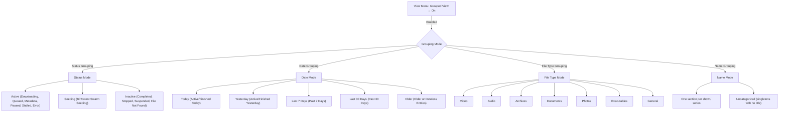

# Table Views & Grouping Architecture

This document provides a comprehensive technical guide to the primary and auxiliary table views in My-IDM, covering model-view architecture, custom delegates, interactive sorting, header spanning, status and date grouping engines, and persistent state lifecycle.

---

## 🏛️ Architecture Overview

My-IDM employs a decoupled Qt Model-View architecture powered by PySide6:

```
┌────────────────────────────────────────────────────────────────────────┐
│                              MainWindow                                │
│  ┌──────────────────────────────────────────────────────────────────┐  │
│  │ CustomHeaderView (Column visibility, sizing, reset, persistence) │  │
│  ├──────────────────────────────────────────────────────────────────┤  │
│  │ QTableView (Primary Download Table)                              │  │
│  │  ├── Model: DownloadTableModel (QAbstractTableModel)            │  │
│  │  │    ├── Filtering: Status filters, Type filters                │  │
│  │  │    ├── Sorting: Type-aware comparator logic                   │  │
│  │  │    └── Grouping Engine: Status-based OR Date-based         │  │
│  │  ├── Delegates:                                                  │  │
│  │  │    ├── ProgressBarDelegate (Col.PROGRESS)                     │  │
│  │  │    ├── DownloadNameDelegate (Col.NAME)                        │  │
│  │  │    ├── SavePathDelegate (Col.SAVE_PATH)                       │  │
│  │  │    ├── QueueColumnDelegate (Col.QUEUE_NAME)                   │  │
│  │  │    └── SectionHeaderDelegate (full-row group headers)         │  │
│  │  └── Spanning: Full-row section headers via setSpan()           │  │
│  └──────────────────────────────────────────────────────────────────┘  │
│  ┌──────────────────────────────────────────────────────────────────┐  │
│  │ DetailsPanel (Collapsible Bottom Panel)                          │  │
│  │  ├── FilesTableWidget (Multi-file torrent priorities)            │  │
│  │  ├── PeersTableWidget (Swarm peer metrics)                       │  │
│  │  ├── TrackersTableWidget (Tracker tier diagnostics)              │  │
│  │  └── SegmentsTableWidget (HTTP segmented chunks)                 │  │
│  └──────────────────────────────────────────────────────────────────┘  │
└────────────────────────────────────────────────────────────────────────┘
```

---

## 📊 Primary Download Table Columns

The main download table exposes 18 columns indexed by the `Col` class:

| Column | Index | Header | Width | Alignment | Description |
| :--- | :---: | :--- | :---: | :--- | :--- |
| `QUEUE` | 0 | `#` | 50 px | Center | Active queue order (1, 2, 3...) for both downloading and queued transfers, starting at 1, or expand/collapse indicator (`▼` / `▶`) in section headers. Width expanded to 50 px to comfortably accommodate multi-digit numbers. |
| `NAME` | 1 | `Name` | 412 px | Left | Filename or resource title with type icon (`📦`, `🎬`, `🧲`) and Tor routing badge (`🧅`). YouTube downloads additionally show an engine tooltip on hover. |
| `SOURCE_DOMAIN` | 2 | `Source Domain` | 187 px | Left | Normalized domain/hostname extracted from the source URL or magnet tracker. |
| `SIZE` | 3 | `Size` | 82 px | Right | Total size formatted via `humanize.naturalsize()` (e.g., `450.2 MiB`). |
| `PROGRESS` | 4 | `Progress` | 214 px | Center | Custom progress bar drawn by `ProgressBarDelegate` with status-based gradient. |
| `STATUS` | 5 | `Status` | 135 px | Left | Capitalized status text with status-specific semantic color coding. |
| `SPEED` | 6 | `Speed` | 166 px | Right | Active transfer rate (`12.4 MiB/s`) or seeding upload rate (`1.2 MiB/s`). |
| `ETA` | 7 | `ETA` | 80 px | Right | Estimated time remaining (`4m 12s`, `1h 05m`), or `—` when paused/inactive. |
| `SEEDS_PEERS` | 8 | `Seeds / Peers` | 140 px | Right | Connected seeds/peers (`S:15 P:42`) for torrents, or segment count (`8 seg`) for HTTP. |
| `ADDED` | 9 | `Added` | 123 px | Center | Localized ISO-8601 datetime (`YYYY-MM-DD HH:MM`) of creation. |
| `LAST_TRIED` | 10 | `Last Tried` | 130 px | Center | Localized datetime of most recent connection/transfer attempt. |
| `COMPLETED` | 11 | `Completed` | 130 px | Center | Localized datetime of successful download completion. |
| `SAVE_PATH` | 12 | `Save Path` | 262 px | Left | Target destination path shortened with leaf-node priority by `SavePathDelegate`. |
| `FILE_NAME` | 13 | `File / Folder Name` | 546 px | Left | Full resolved local file or root folder name on disk (`entry.filename`). |
| `LAST_SEEDED` | 14 | `Last Seeded` | 131 px | Center | When the torrent last started or completed a seed. `—` for non-torrents. |
| `SOURCE` | 15 | `Source` | 110 px | Left | Where the download originated: `Chrome`, `Firefox`, `Edge`, `AnimePahe`, or `YouTube`. Blank for manually added and legacy rows. |
| `SEEDING_STARTED_AT` | 16 | `Seeding Started At` | 173 px | Center | Localized datetime when current seeding session began. Stamped on entering seeding (torrents only). |
| `QUEUE_NAME` | 17 | `Queue` | 30 px | Left | The named queue the download belongs to, painted by `QueueColumnDelegate` as a colour swatch plus the name — **collapsing to the swatch alone when the column is too narrow**, because the colour still identifies the queue whereas an elided name does not. Colours live on the `queues` row and reach the model via `set_queue_colors`; the delegate reads them from a dedicated `QUEUE_COLOR_ROLE`, not `UserRole` (already column-specific) and not by decoding the cell text. See [`queues.md`](queues.md). |

### Column Tail & Upgrades

The default display order is a real arrangement rather than a designed one — it was taken from
a profile that had every column visible and had been dragged around until it stopped being
adjusted:

```
# , QUEUE_NAME, NAME, SIZE, PROGRESS, STATUS, SPEED, ETA, SEEDS_PEERS, ADDED, SAVE_PATH,
COMPLETED, LAST_TRIED, SOURCE_DOMAIN, FILE_NAME, LAST_SEEDED, SOURCE, SEEDING_STARTED_AT
```

Two things in it are not insertion order: the **Queue** badge sits at slot 1 next to the row
number, where the eye already is; and **Save Path** sits with **Completed** and **Last Tried** so
the three "what happened to it" columns are read together. The last five form the right-hand
*tail*, which is the part a stale-state restore has to re-pin (below).

The order is defined once, in `_DEFAULT_COLUMN_ORDER` (`main_window.py`), and applied by
`_apply_default_column_order()` from two places: startup and **View → Reset View**. Default widths
live beside it in `_DEFAULT_COLUMN_WIDTHS` (~3080px total, so a fresh profile scrolls sideways
with all 18 columns visible — deliberate, and the reason two filename columns are wide rather than
truncated).

Both helpers sweep slots in ascending order, because `moveSection()` shifts everything between the
source and the target — placing a column that currently sits *left* of its slot would otherwise
push an already-placed neighbour back out of position.

`LAST_SEEDED`, `SOURCE`, `SEEDING_STARTED_AT` and `QUEUE_NAME` were **appended** (indices 14–17)
rather than inserted, so every pre-existing logical index is unchanged and the persisted
`column_widths`, `header_state`, and `sort_column` in `ui_state` keep addressing the same columns.
That is also why `QUEUE_NAME` is at slot 1 rather than at the end: it is a logical index of 17 and
was never renumbered to match its new position.

`ui_state` also records `column_count`. On restore, if the stored count differs from `Col.COUNT`, the
state predates an append: `QHeaderView.restoreState()` only describes the sections that existed
then, so the new columns can land anywhere. `_apply_default_tail_order()` re-pins the tail to the end
while preserving the user's own ordering of the older columns — deliberately *not* the full
`_apply_default_column_order()`, because this path runs on an existing profile and reordering
everything would discard an arrangement the user never asked to change. Once the state is re-saved
with the current count, custom ordering is respected as-is.

### `Source` Derivation
Resolved at display time from `metadata_json` rather than stored in its own column, so existing rows
classify immediately with no migration or backfill (`resolve_download_source()` in
`download_model.py`):

| Value | Key |
|---|---|
| `YouTube` | `source_type` starts with `youtube` |
| `AnimePahe` | `added_by` contains `animepahe` — written by `load_backlog()` from AnimePahe's `# AnimePahe Download` comment above the URL |
| `Chrome` / `Firefox` / `Edge` | `source == "browser_extension"`, then matched against `user_agent` |
| *(blank)* | Everything else, including manual adds and legacy rows |

Edge is matched on `Edg/` (and legacy `Edge/`) **before** Chrome, because Edge's User-Agent also
advertises `Chrome/`.

---

## 🗂️ Grouped Views & Grouping Models

In addition to standard flat-list display, My-IDM provides **Grouped Views**, dividing the download table into collapsible, full-row-spanning sections.

### 1. View Modes

My-IDM supports four distinct grouping modes configured under **View → 🗂️ Grouped View**:



The mode key set is `GROUPED_MODES = ("status", "date", "type", "name")`, with
`DEFAULT_GROUPED_MODE = "status"`; both are validated on read, so a stale persisted mode
degrades to the default rather than rendering an undefined grouping.

#### Mode Availability Follows the Enable Flag

The four modes only mean something while the table is actually partitioned, so both surfaces that
expose them grey them out together when grouping is off:

| Surface | Widget | Kept in step by |
| :--- | :--- | :--- |
| View menu | `_act_group_by_status` / `_act_group_by_date` / `_act_group_by_type` / `_act_group_by_name` | `MainWindow._sync_grouping_mode_actions`, called from `_setup_menubar` and `_on_toggle_grouped_view` |
| Preferences → 👁️ Views & Columns | `_group_mode_combo` | `SettingsDialog._sync_group_controls`, wired to `_group_enabled_cb.toggled` and called from `_populate_views_tab` |

Two consequences worth knowing:

- **A disabled action keeps its checkmark.** The checkmark is the *remembered* mode, restored when
  grouping is switched back on; clearing it would regroup by Status for a user who had chosen
  File Type or Name. Only `setEnabled` is touched, never `setChecked`.
- **The "picking a mode turns grouping on" shortcut is no longer reachable from the View menu**,
  because the action to pick is disabled. `_set_grouping_mode` still performs the promotion for
  programmatic callers that invoke it directly.

#### The grouping control strip

Between the toolbar and the table sits `_group_control_strip` (`main_window.py:922`, 30 px tall),
holding the grouping controls as first-class widgets rather than menu-only commands:

- **Collapse All / Expand All**, icon-only, at the left edge — **disabled in flat view**, because
  there are no sections to fold;
- a `Group by:` label, then the mode buttons **None / Status / Date / File Type / Name** at the
  right edge, in an exclusive `QButtonGroup` so exactly one is ever checked.

Three rules make it behave like a control rather than a status display:

- **Visibility is independent of grouping.** It used to be hidden whenever grouping was off, so
  the flat view offered no visible way back into a grouped one. Since 2026-10-10 the strip is shown
  whenever `group_strip_visible` is set, and **`None` is the checked button in flat view** — the flat
  table is a choice on the same switch as the grouped ones, not the absence of a choice.
- **The File Type tooltip is read, not retyped.** It is built from `TYPE_SECTION_TITLES`
  (`download_model`), so declaring a new file-type section updates the strip, the View-menu action
  and the tests in one place instead of three copies of a list that drift.
- **It can be hidden.** `_act_toggle_view_toolbar` — labelled **View Control Strip** (renamed from
  "View Toolbar") — is a checkable action in the View menu *and* an icon-only button on the
  toolbar's right end; toggling it persists `group_strip_visible` and shows or hides the strip.

#### A. Status-Based Grouping (`status`)
Partitions downloads according to operational lifecycle state:
1. **Active**: Items in `fetching_metadata`, `queued`, `downloading`, `paused`, `stalled`, `checking`, `scanning`, `threat_detected`, or `error`.
2. **Seeding**: Items actively seeding in the BitTorrent swarm (`seeding`).
3. **Inactive**: Terminated items in `completed`, `stopped`, `file_not_found`, or `suspended`.

#### B. Date-Based Grouping (`date`)
Partitions downloads into relative temporal buckets determined by the **latest** available timestamp among:
- `entry.added_at`
- `entry.completed_at`
- `entry.last_tried_at`

The categorization algorithm (`get_entry_date_category`):
```python
def get_entry_date_category(entry: DownloadEntry, now_dt: Optional[datetime] = None) -> str:
    latest_dt = get_entry_latest_timestamp(entry)
    if latest_dt is None:
        return SECTION_DATE_OLDER

    if now_dt is None:
        now_dt = datetime.now().astimezone()

    today = now_dt.date()
    entry_date = latest_dt.date()
    diff_days = (today - entry_date).days

    if diff_days <= 0:
        return SECTION_DATE_TODAY
    elif diff_days == 1:
        return SECTION_DATE_YESTERDAY
    elif diff_days <= 7:
        return SECTION_DATE_LAST_7_DAYS
    elif diff_days <= 30:
        return SECTION_DATE_LAST_30_DAYS
    else:
        return SECTION_DATE_OLDER
```

Buckets and section IDs both come from `DATE_SECTION_DEFS`, which is also the source of the
header rows' IDs and titles — the classifier and the headers used to spell the same five
literals twice. All five headers are always emitted, so a section that has gone empty renders
as `TODAY (0)` rather than disappearing.

`now_dt` is **injected, never read from the clock at the call site**, matching
`Database.get_download_stats(today=...)`: `_apply_sort(now_dt=None)` and
`_reapply_filter(now_dt=None)` thread it through so the same `now` drives the classification
*and* the staleness bookkeeping below.

#### C. File-Type Grouping (`type`)
Partitions downloads by what the payload *is* rather than when it was added, using the extension
classification in `download_model`. Sections are Video, Audio, Archives, Documents, Photos,
**Executables** and General, with `General` as the catch-all so no download is ever dropped from
the table. Executables is its own section rather than part of Archives because the two behave
differently for the user: an archive is inert until unpacked, while `.exe`, `.msi`, `.apk`,
`.deb`, `.rpm`, `.appimage`, `.dmg`, `.pkg` and friends are the ones the security layer warns
about before a download starts.

`get_entry_type_category()` (`download_model.py:466`) decides in a fixed order:

1. an explicit `metadata["type_category"]` override, so a mis-filed item can be corrected by hand;
2. the extension of `filename`, then of the `file_path` leaf, because the display name is what the
   user recognises — a single-file `.mkv` torrent therefore lands in Video either way;
3. when neither name recognises an extension, the **payload** of a multi-file torrent decides:
   if one category holds more than `TYPE_CATEGORY_PAYLOAD_SHARE` (`:410`, 95%) of the bytes, that
   section gets it. A season folder is 99.99% video plus a handful of `.nfo` / `.jpg` extras and
   the folder itself has no extension, so without this rule the whole series filed under General
   and vanished from Video. The same rule files discography folders as Audio and camera-roll
   folders as Photos.
4. bytes are the weight, so one large episode outweighs any number of thumbnails; when no file
   reports a size (`torrent` lists built before any byte moved) files are counted instead. Exactly
   95% is *not* enough — a genuinely mixed folder is meant to stay in General.

#### D. Name-Based Grouping (`name`)

Added 2026-10-10. Groups downloads by the **show or series** they belong to, so a season folder
and a straggler episode land in the same section instead of two unrelated rows. It answers the
question the other three modes cannot: *File Type* says "12 videos", `name` says "Frieren — 12".

A group's **title** is chosen by `_group_entries_by_name()` (`download_model.py`) in a fixed
order:

1. an explicit `show_title` / `series_title` / `series_name` / **`anime_title`** from
   `metadata_json`, cleaned through the strip-keyword pattern below. AnimePahe writes
   `anime_title=` as a trailing backlog column, which is how a scraped series groups without any
   name parsing at all;
2. for a single-item group with no explicit title, the entry's own display name;
3. for a multi-item group, `_find_common_prefix()` of the members' display names — word-boundary
   aware, minimum 3 characters — falling back to the shortest name;
4. `Group N` when nothing recognisable survives, `Ungrouped …` for leftovers, and a final pass that
   merges groups whose normalised keys collide, preferring the more upper-cased spelling.

**Single items without an explicit title are merged into `Uncategorized`** rather than each
becoming its own section — a list of one-off downloads would otherwise produce as many sections as
rows, which is the same information with more clicks.

Two mechanics make the grouping survive real filenames:

- **Keyword stripping** — `assets/strip_keywords.txt`, 178 lines of release junk (quality
  `1080p` … `hdr10plus`, codecs, `web-dl` / `bluray` / `webrip`, scene tags, release groups
  `animepahe` / `subsplease` / `yts` / `rarbg`, store and crack tags, `www.UIndex.org`). It is
  loaded lazily by `_get_strip_keywords_pattern()`, deduplicated, sorted by **descending length**
  so longer keywords win, and compiled into one word-boundary `\b(?:…)\b` case-insensitive regex.
  A missing or unreadable file falls back to a 30-keyword hardcoded pattern, so grouping degrades
  rather than disappears. The same pattern serves `_extract_show_name`, metadata-title cleaning,
  group-key cleanup and the section fallback.
- **Name extraction** — `_extract_show_name()` drops the extension, takes an AnimePahe fast path
  (`AnimePahe <title> - <ep>`), then strips structural patterns (`S01E01`, `Episode N`, `1x01`,
  `- ep N`, `(2024)`, `[…]`, `(…)`), the strip keywords, a trailing release-group token, and
  finally normalises separators to spaces.

**Matching** is fuzzy, not exact: `_names_are_similar()` accepts identical normalised names or a
Levenshtein distance within **10% of the longer name**, so `Frieren - 01` and `Frieren - 02`
group while `Frieren` and `Fairy Tail` do not. The normalisation
(`_normalize_name_for_grouping`) maps every non-alphanumeric character to a space and lowercases,
so punctuation never splits a group.

Cost is bounded by a cache: `_cached_name_groups` plus the reverse map
`_name_section_map` (download id → section id) are rebuilt together and invalidated together.
The reverse map is **authoritative** for `_entry_section_id()`, rather than recomputing the
grouping per row: a recompute could disagree with the edit-distance placement a row was actually
filed under, and point progress updates at the wrong header. Only entries added after the last
rebuild recompute from metadata or from `_extract_show_name`.

Two behaviours specific to this mode:

- **Name sections start collapsed** on the first build that has entries
  (`_name_sections_auto_collapsed`), because a grouped view of 40 series that spans forty expanded
  rows is worse than a flat list; the flag resets on the next rebuild and clears on a manual
  expand, so the auto-collapse happens once rather than on every refresh.
- **A rename regroups even while the section is collapsed.** `update_filename` and `rename_entry`
  route through `_reapply_filter()` *before* consulting `_id_to_row`, because name sections start
  collapsed and a regroup gated on the visible row never ran in exactly that state — the table kept
  the pre-rename grouping until the next full reset, so a resolved filename left its row under the
  wrong series. (Regression: `tests/test_download_model.py::TestNameGroupingInternals`.)
- Collapse state persists as **dynamic** `ui_state` keys, `grouped_name_<key>_collapsed`
  (`main_window.py`), one per group, since the section set is not knowable in advance.

Header colours: cyan for name groups, purple for `Uncategorized`
(`download_model.py`, section foreground). Renaming a download or resolving a filename forces a
regroup, so a corrected title moves the row immediately.

#### Midnight Rollover

The buckets are relative to the current day, so the grouping is only correct for the day it was
built on. `_apply_sort` reads the clock on every rebuild, but nothing *scheduled* a rebuild, so
a quiet app left open across midnight kept showing yesterday's grouping — including a `TODAY`
section full of yesterday's downloads — until some unrelated event (a status change, a filter, a
sort) happened to reset the model.

`DownloadTableModel` therefore records the local date each date-mode rebuild was built against
(`_grouping_date`) and exposes two methods:

| Method | Behaviour |
| :--- | :--- |
| `date_grouping_is_stale(now_dt=None)` | True only in `date` mode when the local day differs from `_grouping_date`. `None` (never built) counts as stale. |
| `refresh_date_grouping(now_dt=None)` | Rebuilds via `_reapply_filter(now_dt)` if stale; returns whether it rebuilt. |

`MainWindow._on_details_timer_tick` polls `date_grouping_is_stale()` on the existing 1 Hz
`_details_timer` rather than adding a timer of its own: that one already runs on the GUI thread
and keeps ticking while the window is hidden to the tray, which is exactly when a rollover goes
unnoticed. `MainWindow._regroup_for_new_day()` then captures the selected IDs **before** the
rebuild, because a model reset drops the view's selection, and restores them through
`_restore_selection` the same way `_on_toggle_grouped_view` does. `_collapsed_sections`
survives, so sections the user had folded stay folded across the rollover.

`status` and `type` sections have no notion of today, so `date_grouping_is_stale()` returns False
for them and the poll costs one `date()` comparison per second.

### 2. Section Header Spanning & Interactions

- **Full-Row Spans**: `MainWindow._apply_table_spans()` calls `self._table.setSpan(row, 0, 1, Col.COUNT)` for every section header index discovered via `model.get_section_header_row_indices()`.
- **Display Role**: The header row renders:
  ```
  ▼   ACTIVE (4)
  ▶   OLDER (12)
  ```
- **Visual Styling**:
  - Background: `#1e2330`
  - Font: `Segoe UI`, 10 pt Bold
  - Colors:
    - Active / Today: Accent Cyan (`#388bfd` / `#58a6ff`)
    - Seeding / Yesterday: Purple (`#8957e5` / `#bc8cff`)
    - Last 7 Days: Warm Amber (`#ffb74d`)
    - Last 30 Days: Soft Blue (`#64b5f6`)
    - Inactive / Older: Muted Blue-Gray (`#8fa0b5`)
- **Toggling**: Clicking or double-clicking any header row triggers `model.toggle_section_collapsed(row)`, which toggles the section ID in `_collapsed_sections`, triggers `_reapply_filter()`, and immediately updates table spans.
- **Count text, drawn by `SectionHeaderDelegate`** rather than carried in the `DisplayRole`
  (which the model still serves as `▼ TITLE (n)` for tests and tooling). The delegate paints
  `N Active` / `N Seeding` / `N Total`, and the **separator is conditional**: `" / "` between
  Active and Seeding is emitted only when the Active count is non-zero, so a section that is only
  seeding reads `1 Seeding / 3 Total` instead of the old `/ 1 Seeding`, with a leading slash and
  nothing before it. `" / N Total"` keeps its slash whenever either count exists.
- **Group progress bar**: the same delegate draws a 12 px bar beside the count text when the
  section has active entries with progress (`section_active_progress` — summed active bytes). It
  is drawn **only** when there is real progress to show, so an Active section of paused rows shows
  text and no empty bar. Two geometry details are pinned by tests: it sits 10 px after the count
  text, and it is centred on the **glyph cap height** — `font_top + ascent - capHeight/2` — not on
  the row rect, because a row is taller than its text and rect-centering leaves the bar visibly
  low against the label. Width is `min(150, available)`.
- **Select All / Clear Selection button**: Painted at the right edge of every non-empty header row
  (`get_section_select_all_btn_rect`, `SectionHeaderDelegate.paint`), and decided on release from
  `MainWindow._on_table_clicked()`: `_on_select_all_in_section()` when the section is not fully
  selected, `_on_clear_selection_in_section()` when it is.
  **A press on a header row may never change the selection.** `DownloadsTableView.selectionCommand()`
  answers `NoUpdate` for a section header row because Qt's default answer for a non-selectable
  row starts with `Clear`, which wiped a full selection mid-click and left the button handler
  reading "nothing selected" — so *Clear Selection* immediately re-selected the very rows it was
  asked to clear, and the right-click menu likewise still offered *Select All*. The same stale
  read is why the header context menu entry is titled at menu-build time, not at trigger time.

### 3. Header Context Menu

Right-clicking any section header opens a contextual management menu:
- **Expand / Collapse '[Title]' Section**: Toggles the targeted section.
- **Expand All Sections**: Expands all sections in the active view mode.
- **Collapse All Sections**: Collapses all sections in the active view mode.
- **Switch Grouping Mode**: Toggles between all four grouping modes. This submenu is built inside
  the `is_section_header_row` branch of `_show_context_menu`, so it only exists once sections do —
  no separate enable/disable coupling is needed on this third surface.

---

## 💾 State Persistence Lifecycle

All table view configuration and grouping states are persisted in the SQLite `ui_state` table (`Database.set_ui_state` / `Database.get_ui_state`):

| Key | Type | Description |
| :--- | :---: | :--- |
| `grouped_view_enabled` | `bool` | Whether grouped view partitioning is enabled (`True`) or flat list is active (`False`). |
| `grouped_view_mode` | `str` | Active grouping mode: `"status"`, `"date"`, `"type"` or `"name"`. Validated against `GROUPED_MODES` on read; anything else degrades to `DEFAULT_GROUPED_MODE`. |
| `grouped_active_collapsed` | `bool` | Status mode: Active section collapsed state. |
| `grouped_seeding_collapsed` | `bool` | Status mode: Seeding section collapsed state. |
| `grouped_inactive_collapsed` | `bool` | Status mode: Inactive section collapsed state. |
| `grouped_date_today_collapsed` | `bool` | Date mode: Today section collapsed state. |
| `grouped_date_yesterday_collapsed` | `bool` | Date mode: Yesterday section collapsed state. |
| `grouped_date_last_7_days_collapsed` | `bool` | Date mode: Last 7 Days section collapsed state. |
| `grouped_date_last_30_days_collapsed` | `bool` | Date mode: Last 30 Days section collapsed state. |
| `grouped_date_older_collapsed` | `bool` | Date mode: Older section collapsed state. |
| `grouped_name_<key>_collapsed` | `bool` | Name mode: one key **per group**, written dynamically — the group set is not knowable in advance. |
| `group_strip_visible` | `bool` | The grouping control strip between the toolbar and the table is shown (see below). |
| `column_widths` | `dict` | JSON mapping of column indices to interactive pixel widths. |
| `column_visibility` | `dict` | JSON mapping of column indices to visibility booleans. |

On application launch:
1. `MainWindow` queries `grouped_view_enabled` and `grouped_view_mode`.
2. Restores collapsed status for all status and date section keys, and for any persisted
   `grouped_name_<key>_collapsed` keys once the name groups are built.
3. Configures `DownloadTableModel.set_grouped_view(enabled, mode=mode)`.
4. Invokes `_apply_table_spans()` to paint section headers immediately.

> **The mode whitelist must be `GROUPED_MODES`, not a local tuple.** When the `"type"`
> mode was added, `MainWindow.__init__` kept its own `("status", "date")` check, so
> choosing File Type and restarting silently grouped the table by Status again — and
> because the menu entry's checked state is derived from that same value,
> `_act_group_by_type` came back unticked and nothing looked wrong. The same trap applies to
> `"name"`: any second copy of the tuple has to be updated in the same commit, which is why
> `GROUPED_MODE_LABELS` and `TYPE_SECTION_TITLES` exist as single sources for the labels
> the strip button tooltip and the View-menu action both read.
>
> `_on_toggle_grouped_view()` also syncs `_act_grouped_view`'s checkmark (under
> `blockSignals`, to avoid re-entry). Without that, the View-menu checkmark and the table
> drift apart, and it matters mechanically rather than cosmetically:
> `_set_grouping_mode()` enables grouping by calling `setChecked(True)` on that
> action, and `setChecked` emits nothing when the action is *already* checked — so a
> desynchronised action made the enable silently do nothing.

### Preferences ▸ Views & Columns

The Views tab (`settings_dialog.py`) drives the same state through
`_apply_views_tab()`, which applies the enable checkbox **before** the mode:

```python
parent._on_toggle_grouped_view(enabled)          # canonical: applies + persists
if enabled:
    parent._set_grouping_mode(mode)             # only when it should stay on
```

The order is load-bearing. `_set_grouping_mode()` force-*enables* grouping when it is
currently off (choosing a mode from the View menu implies turning it on), so calling it
first meant that saving with the checkbox **unticked** turned grouping back on and
overwrote the `False` the dialog had just written — while the branch that actually applied
the checkbox sat behind an `elif` that could never run, so unticking it did nothing until
the next restart.

---

## 🎨 Custom Item Delegates

### 1. `ProgressBarDelegate` (`my_idm.delegates`)
Renders color-coded progress bars for `Col.PROGRESS`:
- Receives a model dictionary: `{"progress": float, "status": str}`.
- Paints an anti-aliased dark background trough (`#21262d`).
- Draws a proportional fill rectangle with rounded corners (`radius = 3px`).
- Gradient fill color mapped to status:
  - Downloading: Blue (`#1f6feb` → `#388bfd`)
  - Completed: Green (`#238636` → `#2ea043`)
  - Seeding: Purple (`#8957e5` → `#a371f7`)
  - Paused: Amber (`#9e6a03` → `#d29922`)
  - Error / Threat: Red (`#da3633` → `#f85149`)
  - Scanning: Cyan (`#39c5bb` → `#56d4c8`)
- Centers bold percentage text (`85.4%`) with automatic contrast handling.

### 2. `DownloadNameDelegate` (`my_idm.delegates`)
Renders filename and file metadata in `Col.NAME`:
- Eliminates redundant string tags (e.g. `(Tor 🧅)`) when Tor routing is visually indicated by decoration role icons.
- Ensures text clipping with clean ellipsis (`...`) during horizontal window compaction.

### 3. `SavePathDelegate` (`my_idm.delegates`)
Renders destination filesystem paths in `Col.SAVE_PATH`:
- Uses intelligent shortening (`_shorten_path`) that preserves the leaf directory component when the column is narrowed.
- Collapses intermediate parent paths into ellipsis markers (e.g., `C:/…/Movies`) before eliding the leaf node itself.

### 4. `QueueColumnDelegate` (`my_idm.delegates`)
Renders the queue membership badge in `Col.QUEUE_NAME`:
- Reads the swatch `#rrggbb` color from `QUEUE_COLOR_ROLE` and display name from `Qt.DisplayRole`.
- Paints a rounded rectangle swatch with the uppercase first character of the queue name in high-contrast text.
- **Intelligent Compaction**: When the column is narrower than `MIN_TEXT_WIDTH` (28 px), gracefully collapses to the swatch alone without rendering broken, half-elided text.
- Supplies a hover tooltip combining the full queue name with its swatch hex code.

---

## 🔍 Interactive Sorting & Filtering

### 1. Data-Type Aware Sorting
`DownloadTableModel._entry_sort_key(entry, col, ascending)` applies specialized comparator logic:
- **`Col.QUEUE`**: Active queue items sort by priority number; inactive items sort to the bottom.
- **`Col.NAME` / `Col.SOURCE_DOMAIN`**: Case-insensitive alphanumeric collation.
- **`Col.SIZE` / `Col.SPEED`**: Numeric comparison of integer bytes / float bps.
- **`Col.PROGRESS`**: Float percentage value.
- **`Col.ETA`**: Active transfers with numerical ETA rank before inactive (`—`).
- **`Col.ADDED` / `Col.LAST_TRIED` / `Col.COMPLETED`**: Chronological comparison with empty timestamps pushed to the bottom.

### 2. Persistent Selection Remapping
Before executing sort operations, `DownloadTableModel.sort()` captures all persistent selection model indices:
```python
old_ids = [e.id for e in self._entries]
self._apply_sort()
self._rebuild_index()

old_indexes = self.persistentIndexList()
new_indexes = [self.index(self._id_to_row[old_ids[idx.row()]], idx.column()) for idx in old_indexes]
self.changePersistentIndexList(old_indexes, new_indexes)
```
This ensures active row selections and focus rectangles are preserved seamlessly across sorting cycles.

### 3. Status, Type & Size Filtering
`DownloadTableModel.set_status_filter(allowed)`, `set_type_filter(allowed)` and
`set_size_filter(allowed)` enable real-time view filtering without database round-trips:
- Filtering is evaluated dynamically in `_matches_filter(entry)`.
- When filtering changes, `_reapply_filter()` regenerates active entries, recalculates section counts, and refreshes the table.
- Each filter collapses to "no filter" once every option is selected, so a fully-ticked popup
  restores the unfiltered list.
- `clear_filters()` resets the header filters only; it deliberately leaves the toolbar
  search query alone so clearing a status filter cannot wipe what the user is typing.

### 4. Toolbar Quick Search
The toolbar search box (`MainWindow._search_edit`, styled `QLineEdit#toolbar_search`) filters
the table by free text via `set_search_query()`:
- Matching is case-insensitive against the filename, the original name, the URL, and the
  extracted source domain, so `example5` finds `https://example5.com/file.zip`.
- It composes with the header filters — `_matches_filter()` evaluates the search first and then
  the type/size/status filters, so all must agree for a row to stay visible.
- `is_filtered()` reports the search as a filter too, which keeps the "filters active"
  indicator honest.
- Empty input is a no-op, so clearing the box restores the previous view without a rebuild.

### 5. Named-Queue Scope & Filter
Added 2026-10-01. The **Queue** column narrows the view to one queue, or to every queue when
blank (the startup default, and what a deleted queue falls back to), and is also a filterable
header column. See [`queues.md`](queues.md) for the feature itself.

- It is a **filter, not a tab bar**. A scope has to compose with the search box, the header
  chips and grouped view at the same time, so it lives in the model rather than in a widget.
- The gate is `DownloadTableModel._in_queue_scope(entry)`, its own method rather than a line
  inside `_matches_filter`, because `get_size_counts`, `get_status_counts` and `get_type_counts`
  each hand-roll their own filter chain over `_all_entries`. A scope applied in only one of them
  would make the header chip counts disagree with the rows they filter.
- The header filter is a second, independent gate — `_in_queue_filter` — keyed on **queue ids**
  so a rename cannot silently empty the view. `is_filtered()` includes both, so the "filters
  active" indicator and **Reset** account for them.
- Selected via **Edit → Queues** (there is no toolbar combo — the strip is transport and file
  commands only); persisted in
  `ui_state` under `active_queue_id`.

---

## 📋 Details Panel Auxiliary Table Views

When any download row is selected, `DetailsPanel` (`my_idm/details_panel.py`) populates diagnostic telemetry across a left-hand side-tab strip with four modes — **📋 Details**, **🗂️ Queues**, **📄 Console** and **📊 Stats** — of which the first holds the per-download tabs below. The aggregate tabs are documented elsewhere: the Queues table in [`queues.md`](queues.md#details-panel-queues-tab), the embedded tool console in [`main.md`](../architecture/main.md), and the Statistics view in [`statistics.md`](statistics.md).

### 1. Files Table (`FilesTableWidget`)
- Used for multi-file BitTorrent downloads.
- Columns: `#`, `Path`, `Size`, `Progress`, `Priority`, `Status`.
- Features an interactive Priority `QComboBox` (`High`, `Normal`, `Low`, `Skip`) communicating directly with `TorrentEngine.set_file_priorities()`.
- Cell widgets are retained during progress updates to prevent UI flickering.

### 2. Peers Table (`PeersTableWidget`)
- Swarm diagnostics displaying connected BitTorrent peers.
- Columns: `IP:Port`, `Client`, `Progress %`, `Down Speed`, `Up Speed`, `Flags`.
- Populated from `libtorrent` peer info metrics during engine poll ticks.

### 3. Trackers Table (`TrackersTableWidget`)
- BitTorrent tracker swarm health.
- Columns: `Tier`, `URL`, `Status`, `Peers`, `Seeds`, `Scrapes`.
- Shows live tracker response statuses, fail counts, and next announce timers.

### 4. Segments Table (`SegmentsTableWidget`)
- Multi-segment HTTP transfer diagnostics.
- Columns: `Segment #`, `Byte Range`, `Downloaded`, `Progress`, `Speed`, `Status`.
- Displays individual segment worker threads, range offsets, and chunk progress bars.

### 5. Details Panel Overview Copy Buttons
In the **Overview** inspector tab, long metadata fields (URL, Target Save Path, Referrer, Anime Series Page URL, SHA-256 checksum) feature dedicated inline `📋 Copy` buttons that instantly copy the corresponding value to the system clipboard without requiring text highlighting. The whole copy group is **hidden when no download is selected** — an enabled *Copy* button with nothing to copy is a control that lies about the state of the selection.

### 6. Rows pending a batch deletion

A paced batch delete (`StatusJobPool`, 10 ms per row) leaves the selected rows alive in the table
for as long as the queue takes to drain, so the model carries an explicit "on its way out" state
rather than leaving them looking live:

- `DownloadTableModel._deleting_ids` holds the ids, with `mark_deleting(ids)` /
  `unmark_deleting(id)` / `is_deleting(id)` / `is_deleting_row(row)`. Marking emits
  `dataChanged` across the whole row for `DisplayRole`, `ForegroundRole` and `ToolTipRole` —
  the three roles the row's presentation actually depends on.
- The delegates treat it as a **distinct state from disabled**, not as an alias: a pending row is
  drawn at reduced opacity with `Colors.TEXT_DISABLED` foreground, and the status text reads
  `Deleting...`. Searching for a *new* status value is deliberate — a row is neither downloading
  nor deleted, and reusing `disabled` would have made the state invisible to the model's own
  queries.
- `MainWindow` calls `mark_deleting` for the selection when the batch starts and `unmark_deleting`
  per row as each one is removed, so a failed row returns to normal on its own.

---

## 🧭 Status Bar Metrics & Selection Count

The main window status bar provides live telemetry:
- **Selection Count**: Displays real-time multi-selection counts (`"1 of 12 downloads selected"` or `"5 of 12 downloads selected"`). When nothing is selected, shows total download counts.
- **Queue Badge**: Shows active queue assignment for single or uniform selections (`🗃️ AnimePahe`), or count of distinct queues (`🗃️ 3 queues`) for mixed selections.
- **Bandwidth Quota Warnings**: Top-right corner badge lights up yellow when approaching warning thresholds (e.g. 80%) or red when monthly/daily caps are exceeded. Clicking opens Preferences directly to the Bandwidth Limit tab.

---

## ✏️ URL Editing & Expired Address Refresh

Downloads can have their source URLs modified via the context menu:
- **Edit URL**: Allows replacing an expired or updated download link while retaining existing partial progress on disk.
- **Automated YouTube Refresh**: YouTube CDN streaming URLs expire after several hours. When resuming paused or stopped YouTube downloads, My-IDM automatically invokes yt-dlp to re-resolve fresh CDN streaming addresses before connecting.
